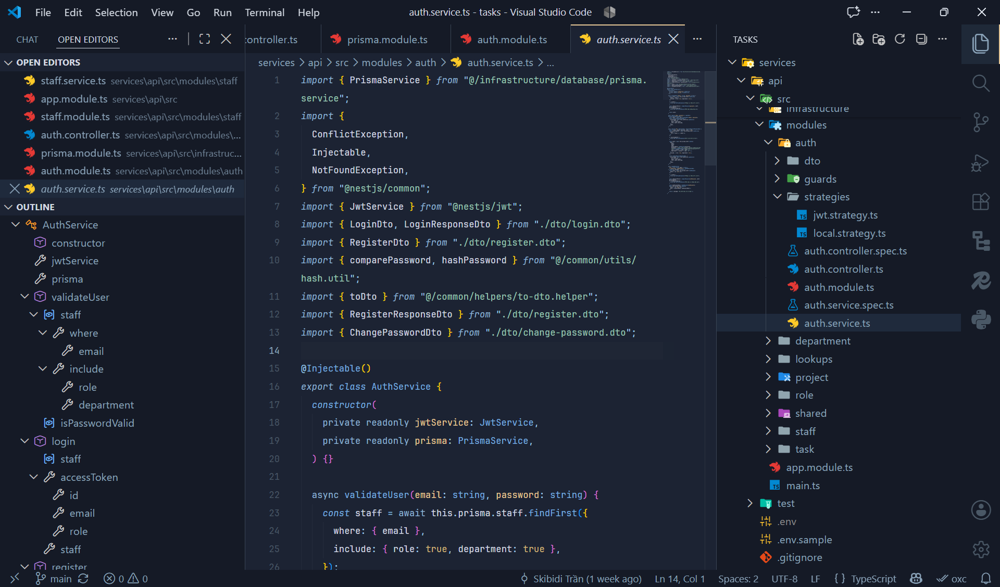

<div align="center">


# The Rain Witch Theme

</div>

**Elegant dark theme for VS Code, inspired by Tonelico (Fate/Grand Order)**

Warm golden accents blended with soft blue tones — a comfortable, visually appealing coding environment.


## Preview

<div align="center">
  
</div>

## Installation

### Via VS Code Marketplace

1. Open VS Code
2. Go to Extensions (`Ctrl+Shift+X` / `Cmd+Shift+X`)
3. Search for **"The Rain Witch Theme"**
4. Click **Install**
5. Press `Ctrl+K Ctrl+T` (`Cmd+K Cmd+T` on Mac) and select **"The Rain Witch Theme"**

### Manual Installation

1. Download the latest release from the repository
2. Copy the folder to your VS Code extensions directory:

   | OS | Path |
   |---|---|
   | Windows | `%USERPROFILE%\.vscode\extensions` |
   | macOS | `~/.vscode/extensions` |
   | Linux | `~/.vscode/extensions` |

3. Reload VS Code
4. Select the theme from the Color Theme picker

## Recommended Settings

For the best experience, add these to your `settings.json`:

```json
{
    "editor.fontFamily": "JetBrains Mono",
    "editor.fontLigatures": true,
    "editor.fontSize": 12,
    "editor.lineHeight": 2,
    "editor.cursorBlinking": "expand",
    "editor.cursorSmoothCaretAnimation": "on",
    "editor.bracketPairColorization.enabled": true,
    "editor.smoothScrolling": true,
    "workbench.iconTheme": "material-icon-theme",
    "workbench.colorTheme": "The Rain Witch Theme"
}
```

---

**Enjoy coding with The Rain Witch Theme! ✨**

If you like it, consider ⭐ starring the repo and sharing it with others.
